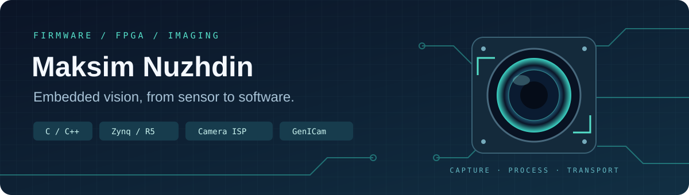

# Maksim Nuzhdin

**Embedded Engineer · Camera Firmware · FPGA & Embedded Vision**

Based in Haifa, Israel. I develop embedded software and firmware for camera systems, with a focus on device control, image acquisition, hardware interfaces and debugging across firmware, FPGA and host software.

  
  
  
  
  

## Core competencies

- **Embedded C/C++:** camera firmware, device drivers, register maps, peripheral control and hardware bring-up.
- **Camera interfaces and control:** GenICam/GenApi XML, GigE Vision, CoaXPress, MIPI CSI-2 and V4L2 integration.
- **FPGA and SoC development:** AMD/Xilinx Zynq UltraScale+, Vivado, Vitis, RTL/HLS integration and image-processing pipelines.
- **System integration and debugging:** acquisition timing, exposure and trigger control, image transport, firmware updates and customer issue investigation.
- **Engineering tools:** Python utilities, automated checks, Git and technical documentation.

## Contact

[LinkedIn](https://www.linkedin.com/in/maksim-nuzhdin-07ab96242/)

